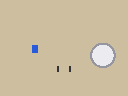
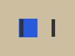
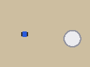
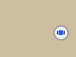

# 2026-01-15_0199c0de_00

**Task prompt**

> Put the blue block into the bowl using tools/robot_ctl.py (session runs/demo_000).

**Instruction:** Put the blue block into the bowl.

gpt-5-codex · profiles cell-queue, default · 7 steps · started 2026-01-15T09:00:00.000Z

Result (cell_queue): `{"task_success": true, "stop_reason": "agent_finish", "native_actions": 280}`

## Step 0 · `python robot_ctl.py cell` · 09:00:18

### Observation



- read `view_image`: cam_head.png
- read `python robot_ctl.py ack_visual`: output.observation_index: 0
- state: observation_index=1, instruction=Put the blue block into the bowl., native_action_index=0, native_budget=600

### Analysis

> User: Put the blue block into the bowl using tools/robot_ctl.py (session runs/demo_000).

> Start from the head camera to locate the block and the bowl.

- note: ack step 0
- evidence: Head: blue block on the left of the table, white bowl on the right; gripper open above the centre.
- note: hover above the block
- code comment: hover 10 cm above the block, estimated from the head camera

### Action

```python
BLOCK = np.array([0.42, -0.12, 0.03])
# hover 10 cm above the block, estimated from the head camera
print(robot.reachable(BLOCK + [0, 0, 0.10]))
print(robot.move_to(BLOCK + [0, 0, 0.10], speed=0.15))
```

Control calls:
- `robot.move_to([0.42, -0.12, 0.13], speed=0.15)`

### Outcome

exit 0 · 1.2 s · native actions 0 → 48 (+48) · 1 primitive call(s)

```
output.stdout:
True
Move(target=[0.42, -0.12, 0.13], reached=True, steps=48)
output.native_actions: 48
output.episode_ended: false
observation.observation_index: 2
observation.instruction: Put the blue block into the bowl.
observation.native_action_index: 48
observation.native_budget: 600
observation.robot_state.tcp: [0.42, -0.12, 0.13]
observation.robot_state.gripper_width: 0.08
observation.images.cam_head: /workspace/demo/runs/demo_000/observations/0002/cam_head.png
observation.images.cam_wrist: /workspace/demo/runs/demo_000/observations/0002/cam_wrist.png
observation.image_sha256.cam_head: 9487d7d022cf53a819f812e91187fa4e22df0f58f024709f8c600965c969cfbd
observation.image_sha256.cam_wrist: 9039e148d017bd44f876fbe01f094e4d158404d1865eae9e48180e159919db3e
```

## Step 1 · `python robot_ctl.py cell` · 09:00:38

### Observation



- read `view_image`: cam_wrist.png
- read `python robot_ctl.py ack_visual`: output.observation_index: 2
- state: observation_index=3, instruction=Put the blue block into the bowl., native_action_index=48, native_budget=600

### Analysis

> The wrist view shows the block left of the finger centre line, so the head estimate was off in y by about 1.5 cm.

- note: ack step 1
- evidence: Wrist: block ~9 px (about 1.5 cm) left of the finger centre; fingers open.
- note: correct y and descend
- code comment: wrist view: block 1.5 cm further left than the head estimate

### Action

```python
BLOCK = np.array([0.42, -0.135, 0.03])
# wrist view: block 1.5 cm further left than the head estimate
robot.move_to(BLOCK + [0, 0, 0.10], speed=0.15)
robot.move_to(BLOCK + [0, 0, 0.015], speed=0.05)
```

Control calls:
- `robot.move_to([0.42, -0.135, 0.13], speed=0.15)`
- `robot.move_to([0.42, -0.135, 0.045], speed=0.05)`

Adjustments against earlier steps:
- `robot.move_to` vs step 0: args[0] [0.42, -0.12, 0.13] → [0.42, -0.135, 0.13] (Δ [0.0, -0.015, 0.0], |Δ| 0.015)

### Outcome

exit 0 · 1.2 s · native actions 48 → 90 (+42) · 2 primitive call(s)

```
[observation 4, native 90/600, ack_required True]
```

## Step 2 · `python robot_ctl.py cell` · 09:00:57

### Observation


- read `view_image`: cam_wrist.png
- read `python robot_ctl.py ack_visual`: output.observation_index: 4
- state: observation_index=5, instruction=Put the blue block into the bowl., native_action_index=90, native_budget=600

### Analysis

> Fingers straddle the block; close and lift.

- note: ack step 2
- evidence: Wrist: fingers straddle the block, about 1 cm above the table.
- note: grasp and lift

### Action

```python
robot.set_gripper(0.0)
robot.move_by([0, 0, 0.12], speed=0.1)
print(robot.state().gripper_width)
```

Control calls:
- `robot.set_gripper(0.0)`
- `robot.move_by([0, 0, 0.12], speed=0.1)`

### Outcome

exit 0 · 1.2 s · native actions 90 → 130 (+40) · 2 primitive call(s)

```
output.stdout: 0.031

output.native_actions: 40
output.episode_ended: false
observation.observation_index: 6
observation.instruction: Put the blue block into the bowl.
observation.native_action_index: 130
observation.native_budget: 600
observation.robot_state.tcp: [0.42, -0.135, 0.165]
observation.robot_state.gripper_width: 0.031
observation.images.cam_head: /workspace/demo/runs/demo_000/observations/0006/cam_head.png
observation.images.cam_wrist: /workspace/demo/runs/demo_000/observations/0006/cam_wrist.png
observation.image_sha256.cam_head: a6a5f00f75f228a37e8acc3e801d881f73a19ed78a26f1ae71fd3c3f785060d1
observation.image_sha256.cam_wrist: 7557e56681900bd462e3a39e590d609cf9b59df64b3e3f97c68629a3a717eee9
```

## Step 3 · `python robot_ctl.py cell` · 09:01:17

Flags: action_failed

### Observation



- read `view_image`: cam_head.png
- read `python robot_ctl.py ack_visual`: output.observation_index: 6
- state: observation_index=7, instruction=Put the blue block into the bowl., native_action_index=130, native_budget=600

### Analysis

> Holding the block. Carry it high over the bowl to stay clear of the rim.

- note: ack step 3
- evidence: Head: block lifted in the gripper; bowl unchanged on the right.
- note: carry over the bowl

### Action

```python
BOWL = np.array([0.40, 0.18, 0.05])
robot.move_to(BOWL + [0, 0, 0.30], speed=0.15)
```

Control calls:
- `robot.move_to([0.4, 0.18, 0.35], speed=0.15)`

Adjustments against earlier steps:
- `robot.move_to` vs step 1: args[0] [0.42, -0.135, 0.045] → [0.4, 0.18, 0.35] (Δ [-0.02, 0.315, 0.305], |Δ| 0.438919); speed 0.05 → 0.15 (Δ 0.1)

### Outcome

exit 1 · 1.2 s · native actions 130 → 130 (+0)

```
error: IK failed: target z=0.35 m is above the workspace (max 0.32 m)
observation.observation_index: 8
observation.instruction: Put the blue block into the bowl.
observation.native_action_index: 130
observation.native_budget: 600
observation.robot_state.tcp: [0.42, -0.135, 0.165]
observation.robot_state.gripper_width: 0.031
observation.images.cam_head: /workspace/demo/runs/demo_000/observations/0008/cam_head.png
observation.images.cam_wrist: /workspace/demo/runs/demo_000/observations/0008/cam_wrist.png
observation.image_sha256.cam_head: a6a5f00f75f228a37e8acc3e801d881f73a19ed78a26f1ae71fd3c3f785060d1
observation.image_sha256.cam_wrist: 7557e56681900bd462e3a39e590d609cf9b59df64b3e3f97c68629a3a717eee9
```

## Step 4 · `python robot_ctl.py cell` · 09:01:31

Flags: human_input

### Observation

- state: observation_index=8, instruction=Put the blue block into the bowl., native_action_index=130, native_budget=600

### Analysis

> User: Go slower near the bowl, please.

> The carry height was out of reach and the user asked for less speed: 15 cm above the bowl at 0.06 m/s.

- note: carry over the bowl, lower and slower

### Action

```python
BOWL = np.array([0.40, 0.18, 0.05])
robot.move_to(BOWL + [0, 0, 0.15], speed=0.06)
```

Control calls:
- `robot.move_to([0.4, 0.18, 0.2], speed=0.06)`

Adjustments against earlier steps:
- `robot.move_to` vs step 3: args[0] [0.4, 0.18, 0.35] → [0.4, 0.18, 0.2] (Δ [0.0, 0.0, -0.15], |Δ| 0.15); speed 0.15 → 0.06 (Δ -0.09)

### Outcome

exit 0 · 1.2 s · native actions 130 → 205 (+75) · 1 primitive call(s)

```
id: d27f09cee001db75b3ce16b611b948ae
pending: true
```

Result delivered by `python robot_ctl.py poll`:
```
output.native_actions: 75
output.episode_ended: false
observation.observation_index: 9
observation.instruction: Put the blue block into the bowl.
observation.native_action_index: 205
observation.native_budget: 600
observation.robot_state.tcp: [0.4, 0.18, 0.2]
observation.robot_state.gripper_width: 0.031
observation.images.cam_head: /workspace/demo/runs/demo_000/observations/0009/cam_head.png
observation.images.cam_wrist: /workspace/demo/runs/demo_000/observations/0009/cam_wrist.png
observation.image_sha256.cam_head: abc90639169e82a23006c4d358e28bde3e02c0a65bb8cf3c57121d21d254ff7c
observation.image_sha256.cam_wrist: ff74f6ea72bb25e9f6ba5e0aaec13aee0636a9573d59822eb601a61a20be406b
```

## Step 5 · `python robot_ctl.py cell` · 09:01:57

### Observation

 

- read `view_image`: cam_head.png
- read `view_image`: cam_wrist.png
- read `python robot_ctl.py ack_visual`: output.observation_index: 9
- state: observation_index=10, instruction=Put the blue block into the bowl., native_action_index=205, native_budget=600

### Analysis

> Block is centred above the bowl; lower it inside and release.

> Submitted asynchronously; polling for the result.

- note: ack step 5
- evidence: Wrist: block centred over the bowl, about 10 cm above the rim.
- note: lower and release

### Action

```python
robot.move_to(BOWL + [0, 0, 0.06], speed=0.04)
robot.set_gripper(0.08)
robot.move_by([0, 0, 0.10], speed=0.1)
```

Control calls:
- `robot.move_to([0.4, 0.18, 0.11], speed=0.04)`
- `robot.set_gripper(0.08)`
- `robot.move_by([0, 0, 0.1], speed=0.1)`

Adjustments against earlier steps:
- `robot.move_to` vs step 4: args[0] [0.4, 0.18, 0.2] → [0.4, 0.18, 0.11] (Δ [0.0, 0.0, -0.09], |Δ| 0.09); speed 0.06 → 0.04 (Δ -0.02)
- `robot.set_gripper` vs step 2: args[0] 0.0 → 0.08 (Δ 0.08)
- `robot.move_by` vs step 2: args[0] [0, 0, 0.12] → [0, 0, 0.1] (Δ [0, 0, -0.02], |Δ| 0.02)

### Outcome

exit 0 · 1.2 s · native actions 205 → 280 (+75) · 3 primitive call(s)

```
output.native_actions: 75
output.episode_ended: false
observation.observation_index: 11
observation.instruction: Put the blue block into the bowl.
observation.native_action_index: 280
observation.native_budget: 600
observation.robot_state.tcp: [0.4, 0.18, 0.21]
observation.robot_state.gripper_width: 0.08
observation.images.cam_head: /workspace/demo/runs/demo_000/observations/0011/cam_head.png
observation.images.cam_wrist: /workspace/demo/runs/demo_000/observations/0011/cam_wrist.png
observation.image_sha256.cam_head: 3637f9bc1e3fd2916b03de745e2d9d1e417269b03eba7a01828db48bc9be4919
observation.image_sha256.cam_wrist: ba9acc664499ec0f45b5ffc113692e5dd9ba5443c2cdf8c366f9cd36b15a4c84
```

## Step 6 · `python robot_ctl.py finish` · 09:02:17

### Observation



- read `view_image`: cam_head.png
- read `python robot_ctl.py ack_visual`: output.observation_index: 11
- state: observation_index=12, instruction=Put the blue block into the bowl., native_action_index=280, native_budget=600

### Analysis

> The block is in the bowl and the gripper is clear; finish the episode.

- note: ack step 6
- evidence: Head: block inside the bowl; gripper open and clear.
- note: block placed in the bowl

### Action

```bash
python tools/robot_ctl.py --session runs/demo_000 --note 'block placed in the bowl' finish
```

### Outcome

exit 0 · 1.2 s · native actions 280 → 280 (+0)

```
output.episode_ended: true
observation.observation_index: 13
observation.instruction: Put the blue block into the bowl.
observation.native_action_index: 280
observation.native_budget: 600
observation.robot_state.tcp: [0.4, 0.18, 0.21]
observation.robot_state.gripper_width: 0.08
observation.images.cam_head: /workspace/demo/runs/demo_000/observations/0013/cam_head.png
observation.images.cam_wrist: /workspace/demo/runs/demo_000/observations/0013/cam_wrist.png
observation.image_sha256.cam_head: 3637f9bc1e3fd2916b03de745e2d9d1e417269b03eba7a01828db48bc9be4919
observation.image_sha256.cam_wrist: ba9acc664499ec0f45b5ffc113692e5dd9ba5443c2cdf8c366f9cd36b15a4c84
```

## After the last action

> The blue block is in the bowl and the episode is finished.
